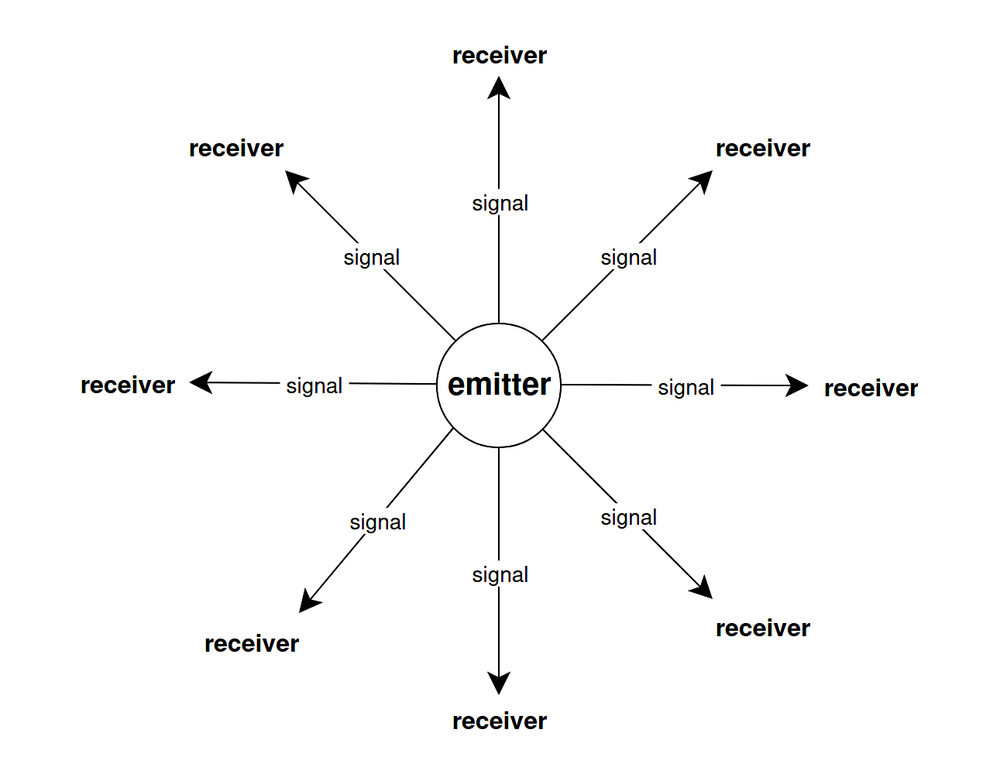
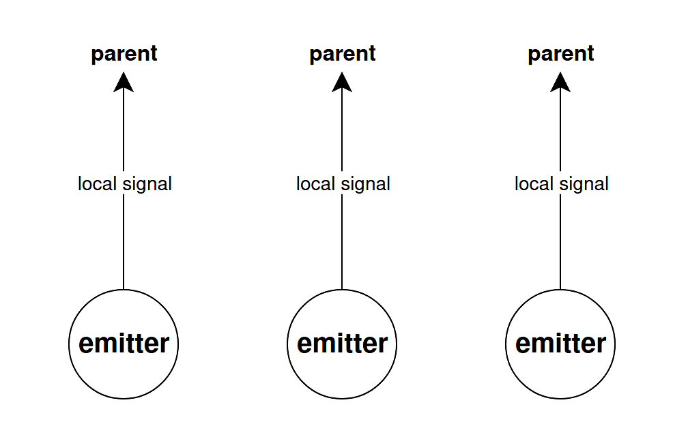

Signals
=======

Signals provide an easy way for objects to communicate without holding references to each other. Objects can *emit* signals, which are then *caught* by others. With this feature, you can easily respond to events of interest in your game.



*Available since:* SurgeScript 7

Basics
------

Consider this example: when a button is pressed, you want to open a door. In this scenario, a button object emits a signal communicating that it has just been pressed. A door object then catches that signal and opens itself in response to that occurrence. Button and door don't need to hold references to each other: they communicate by means of a signal, with no tight coupling.

In code, we proceed as follows:

1. We declare the signal
2. The emitter object emits the signal
3. Other objects catch the signal using its name

Example:

```cs
// We begin by declaring a signal named "button pressed"
signal "button pressed" { }

// Emitter: Object "Button" emits "button pressed" signals
object "Button"
{
    state "main"
    {
    }

    fun press()
    {
        Console.print("The button was pressed");

        // We emit a signal whenever an event of interest happens
        emit "button pressed";
    }
}

// Receiver: Object "Door" catches "button pressed" signals
object "Door"
{
    state "main"
    {
    }

    // This is a signal handler. Here we respond to the event of interest
    catch "button pressed"
    {
        open();
    }

    fun open()
    {
        Console.print("A door was opened");
    }
}

// Let's write a simple test
object "Application"
{
    button = spawn("Button");
    door = spawn("Door");

    state "main"
    {
        button.press();
        state = "done";
    }

    state "done"
    {
    }
}
```

The output of this program is:

```
The button was pressed
A door was opened
```

As soon as `button.press()` is called by the application, the `"button pressed"` signal is emitted by the button. That signal is immediately caught by the door, which opens itself.

Note that `button` and `door` do not hold references to each other. Moreover, if we extend the above example to include multiple doors, then **all doors** will catch the signal:

```cs
...

object "Application"
{
    button = spawn("Button");
    doors = [ spawn("Door"), spawn("Door"), spawn("Door") ];

    ...
}
```

This extended version of the application spawns three doors. Since each door prints a message, the output of the program is:

```
The button was pressed
A door was opened
A door was opened
A door was opened
```

Note what just happened: with the same structure of the previous example, a single emitter (button) notified multiple objects (doors) of an event of interest (the button was just pressed).

!!! info "Convention for signal handlers"

    The `catch` blocks are also known as *signal handlers*. They must be placed immediately after the states of an object (before the functions, if any).

!!! note "Signal names"

    As of SurgeScript 7, the signal name passed to `emit` must be a string literal. This constraint helps to determine at compile-time all signals that can be emitted by an object.

Naming convention
-----------------

All signals have a name. Signal names should briefly describe an action or change that has just occurred. When naming your signals, abide by the following convention as much as possible:

_signal name = subject + verb in the past tense_

The *subject* refers to the subject that has received the action or whose internal state has changed. The *verb* refers to the action or change itself. Use lowercase letters for both. Take a look at some examples of names that follow and that do not follow the convention:

| ✅ Use | ❌ Avoid |
|--------|----------|
| `"button pressed"` | `"press button"` |
| `"powerup collected"` | `"collect powerup"` |
| `"level cleared"` | `"clear"` |
| `"player killed"` | `"player death"` |
| `"boss defeated"` | `"BOSS DEFEATED"` |
| `"life gained"` | `"Extra Life"` |
| `"points gained"` | `"add to score"` |
| `"energy recharged"` | `"Update UI"` |

You may read the signal name `"boss defeated"` as _a boss was defeated just now_. You may read other signal names similarly.

Context
-------

It's often useful to attach data to a signal. For example, if a button is pressed, we may wish to know which character pressed it. If the player has scored points, we may wish to know just how many points. We can think of many other examples. In any case, the additional data, if present, depends on the nature of the signal. We call such additional data the *context* of the signal.

Suppose that radio stations of a game world emit signals as soon as starting to broadcast a program. Those signals include additional data: the name and the host of the show. Let's declare a signal with this context:

```cs
signal "broadcast started"
{
    show,
    host
}
```

This code means that signals named `"broadcast started"` carry a context with two fields: `show` and `host`. Note that you can specify multiple fields by separating them with commas.

Whenever a radio station emits a `"broadcast started"` signal, it must include the appropriate context. Such context must be provided as an [anonymous object](./anonymous_objects.md) featuring two [properties](./properties.md): `show` and `host`. It's written after the signal name, as in the following example:

```cs
object "Gamedev Radio Station"
{
    ONE_SECOND = 1;
    ONE_MINUTE = 60 * ONE_SECOND;
    ONE_HOUR = 60 * ONE_MINUTE; // one hour == 3600 seconds

    state "main"
    {
        state = "broadcasting stories";

        // Let's emit a signal
        // "broadcast started" is the name of the signal
        // { show = ... , host = ... } is the context
        emit "broadcast started" {
            show = "Gamedev Stories",
            host = "Surge the Rabbit"
        };
    }

    state "broadcasting stories"
    {
        if(timeout(ONE_HOUR)) {
            state = "broadcasting music";
            emit "broadcast started" {
                show = "Video Game Music Show",
                host = "Neon the Squirrel"
            };
        }
    }

    state "broadcasting music"
    {
        if(timeout(ONE_HOUR)) {
            state = "broadcasting news";
            emit "broadcast started" {
                show = "Gamedev News",
                host = "Tux the Penguin"
            };
        }
    }

    state "broadcasting news"
    {
        if(timeout(ONE_HOUR)) {
            state = "broadcasting stories";
            emit "broadcast started" {
                show = "Gamedev Stories",
                host = "Surge the Rabbit"
            };
        }
    }
}
```

In this example, object Gamedev Radio Station broadcasts three shows: Gamedev Stories, Gamedev News, and Video Game Music Show, each with a different host. Individual radio receivers may pick them up by accessing the context of the emitted signals in a `catch` block.

The `signal` keyword, when typed inside a `catch` block, references a special [Signal](../reference/signal.md) object containing data about the received signal. Its most important properties are:

| Property | Description |
| ---------|-------------|
| `signal.context` | The context of the signal |
| `signal.emitter` | The object that emitted the signal |

In our example, `signal.context` is an object with two fields: `show` and `host`. Moreover, `signal.emitter` is the Gamedev Radio Station object. Let's see how individual radio receivers may pick up those signals:

```cs
object "Radio Receiver"
{
    state "main"
    {
    }

    catch "broadcast started"
    {
        show = signal.context.show;
        host = signal.context.host;

        Console.print("Welcome to our show, " + show);
        Console.print("I am your host, " + host);
    }
}
```

The above radio receiver works fine if there is only a single station, but what if there are more? Since it picks up signals named `"broadcast started"` emitted by **any** object, this means that it picks up the programs broadcasted by **all** radio stations. This is not what we want, for a radio receiver should be tuned only to a single station of choice. Luckily, this is easy to fix. We can simply check if `signal.emitter` is our station of choice:

```cs
object "Radio Receiver"
{
    public station = "Gamedev Radio Station";

    state "main"
    {
    }

    catch "broadcast started"
    {
        // stop execution if we've caught the wrong station
        if(signal.emitter.__name != station)
            return;

        show = signal.context.show;
        host = signal.context.host;

        Console.print("Welcome to our show, " + show);
        Console.print("I am your host, " + host);
    }
}
```

Now, tuning the receiver to a different station is just a matter of changing its `station` variable.

!!! info "Required fields"

    Object `signal.context` is guaranteed to contain all fields specified in the declaration of the signal. It is an error to emit a signal without all the required fields. If no fields are specified in the declaration of the signal, then there is no context and `signal.context` evaluates to `null`.

!!! tip

    You can easily inspect the fields of any signal context simply by printing it: `Console.print(signal.context);`

!!! warning

    The special `signal` object may not be accessed outside of a `catch` block. Storing a reference to it is an error that leads to undefined behavior.

Local signals
-------------

Signals are _global_ by default. They are broadcasted to all objects with a matching `catch` block. _Local signals_ work differently. They are used by [components](./components.md) in order to communicate some occurrence. Unlike global signals, **local signals can only be caught by the [parent](./object_tree.md) of the emitter**. Objects other than the parent of the emitter cannot catch them, even if they have a matching `catch` block. Consequently, for any given local signal, if the parent of the emitter does not implement a matching `catch` block, then that local signal will be lost.



In order to make a signal local, all you need to do is prefix its declaration with the `local` qualifier:

```cs
local signal "component changed"
{
}
```

In order to see the usefulness of local signals, consider the example of a spaceship that spawns a [Timer component](../reference/timer.md) to shoot lasers at predefined times. Here, the Timer component emits a local signal called `"timer fired"` every second. It's not relevant for all other objects of the game to know when that internal timer of the spaceship has fired. That occurrence is only relevant for the spaceship itself. Let's see an example:

```cs
using SurgeScript.Timer;

object "Spaceship"
{
    timer = Timer()
            ..waitTime = 1.0
            ..repeat = true
            ..start();

    state "main"
    {
    }

    // we'll catch this signal every second
    catch "timer fired"
    {
        shoot();
    }

    fun shoot()
    {
        Console.print("Spaceship: SHOOT!");
    }
}
```

Since a local signal can only be caught by the parent of the emitter, it follows that the Timer of a spaceship does not interfere with the Timer of another spaceship. They are independent.

Now, consider this scenario: what if a spaceship holds multiple Timers, say, one for shooting and another for blinking? Each Timer will emit a `"timer fired"` signal. How can we distinguish between the two? We can use `signal.emitter`. Example:

```cs
using SurgeScript.Timer;

object "Spaceship"
{
    shootTimer = Timer()
                 ..waitTime = 1.0
                 ..repeat = true
                 ..start();

    blinkTimer = Timer()
                 ..waitTime = 0.25
                 ..repeat = true
                 ..start();

    state "main"
    {
    }

    catch "timer fired"
    {
        if(signal.emitter == shootTimer) {
            shoot();
        }
        else {
            blink();
        }
    }

    fun shoot()
    {
        Console.print("Spaceship: SHOOT!");
    }

    fun blink()
    {
        Console.print("Spaceship: blink");
    }
}
```

Local signals lets us reuse the basic architecture of global signals in order to solve a different problem in an elegant way.